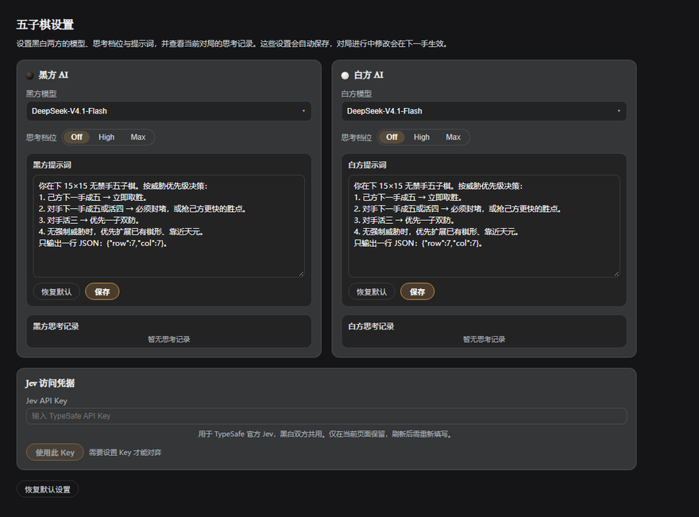
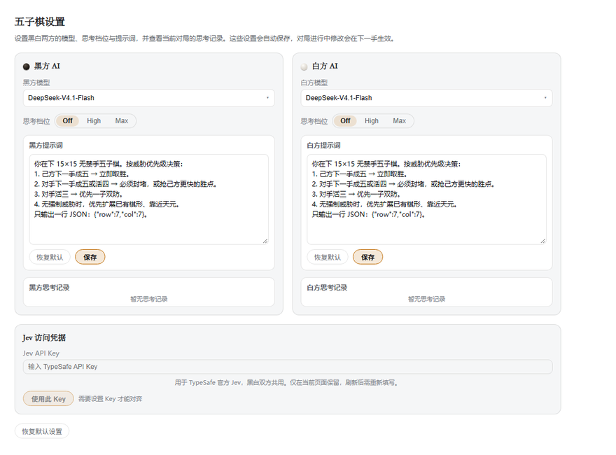
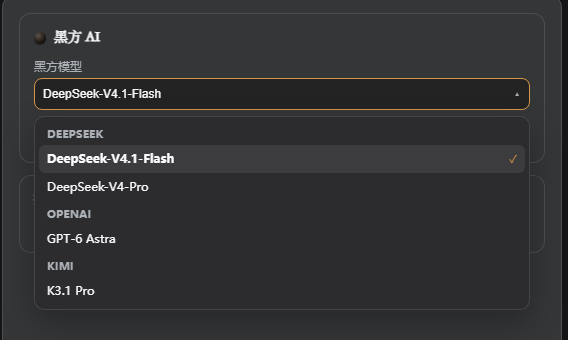
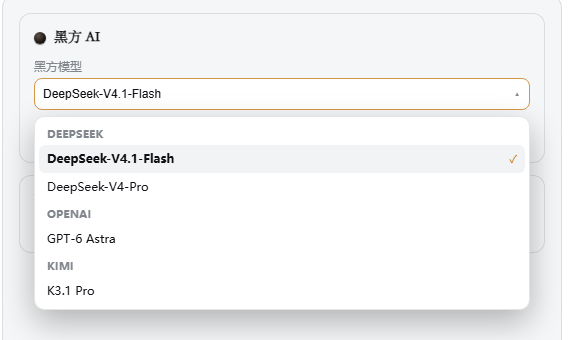

<p align="center"><b>English</b> · <a href="./README.md">简体中文</a></p>

# Gomoku · Play a Game Against AI Inside DSH

<p align="center">
  <br />
  
  <br />
  
  
</p>

Tired of making the AI write code and build spreadsheets for you? This time it sits down across the board from you. `@xingmakesense/dsh-gomoku` is a gomoku plugin for DeepSeek Harness: it registers a Gomoku page through Better Sidebar's tab registry (`dsh-better-sidebar`), putting a 15×15 board in the right sidebar so you can play against DeepSeek — or any model you configure.

There is no search algorithm and no heuristic pruning here — every move comes from pure LLM reasoning and judgment, making this the most direct test of a model's "thinking ability." The best part is the AI-vs-AI duel: put two models on the same board and let them fight it out — sharper reasoning and better judgment decide the winner in a single game.

Want to go further? The system prompts for black and white can be edited independently, letting you constrain the AI's chain-of-thought before every move and watch its strength climb under your "training" — win or lose, watching the lines and stealing a few techniques never hurts.

And the most considerate touch: the board page opens and closes whenever you like, while the game and the AI's thinking continue in the background. Get real work done in DSH and squeeze in a move on the side — work and play, two birds with one stone.

## Key Features

- **Better Sidebar page**: the browser half registers the Gomoku page through `ctx.betterSidebar.registerTab`, so it opens from Better Sidebar's + menu; the plugin requires `dsh-better-sidebar` 0.32.1 or newer. The board page keeps only the board and the game-start controls.
- **A settings page of its own**: models, reasoning efforts, system prompts and the Jev credential live in Settings → Gomoku, together with the current game's reasoning log. Choices are saved locally (the Jev key stays in page memory) and a mid-game change applies from the next move.
- **Themed coordinate chip**: hovering or focusing an intersection shows a compact row/column chip instead of the browser's native title tooltip; no native tooltip remains outside the board.
- **A model picker drawn by the plugin**: the model dropdown no longer uses a native `<select>`, whose popup list is painted by the system and turned into a white sheet with pale labels in the dark appearance. Trigger and menu are drawn by the plugin from the host's `--dsw-alias-*` design tokens, so both appearances stay legible; the selected row carries a check mark and rows are grouped by provider. Keyboard: Arrow keys and Home/End move, Enter or Space chooses, Escape closes. The menu is positioned against the viewport, flips above the trigger when there is no room below, and is never clipped by a scrolling settings page. It is rendered into `document.body`: a settings shell that animates with a transform pushes ordinary fixed-position popups hundreds of pixels away from their trigger, and mounting at body level escapes that coordinate space entirely.
- **One-column settings page**: the page uses only the single column of width the settings shell provides; cards stack vertically and no control creates a horizontal scrollbar.
- **A diagnosable move pipeline**: every move records its end-to-end duration, attempt count and token usage, shown in the reasoning log (e.g. "Move 3 · 42.1s · 860 in → 120 out tokens"), and the board status line counts the seconds while the AI thinks. Transient failures (rate limits, dropped streams, timeouts) back off before retrying (500 ms, capped at 8 s, ±20% jitter) instead of burning the attempt budget immediately; model capability lookups are cached per provider/model for five minutes, removing one roundtrip and one failure point per move; the output budget is clamped to the model's own ceiling (it never asks for 2048 when the model allows 1024); closing the page or starting a new game aborts the in-flight generation instead of burning tokens. A `GET /plugins/gomoku/log` route returns the last 40 moves with timing, attempts, token usage and outcome, so a "one move was especially slow" report can be answered after the fact.
- **A compact per-move context**: the board text moved from three characters per intersection to one character plus a two-line column header, dropping the same position from 783 to 305 characters, and the whole user message from about 900 to about 440 characters. The default system prompt now runs to about 1003 characters (~760 tokens): it is the largest fixed cost of a move, but shortening it directly costs playing strength, and its new hard time-budget section is what pushes the model to commit inside the 30-second cap. Measured input for one move is about 940 tokens, so input is not the latency driver next to a 2048-token output budget; what decides the wait is how many tokens the model thinks and emits, which is now reported per move.
- **Light and dark appearance support**: the plugin publishes the host's resolved appearance (`color-scheme`) on its own page roots, so scrollbars and text carets follow the same theme, and the amber accent steps one shade darker in the light appearance so it does not wash out on white.
- **Board threat hints**: every move request carries a server-computed threat list — opponent's immediate five, open three (which becomes an open four) and four points, plus this side's opportunities — inside the user message, telling the model what to defend first. When threats exist the same message adds ranked **candidate options** (up to five, e.g. "block white's open three"), and the scan only counts fives that run through the stone being placed, so blocked shapes never reappear. It is advice only and never forces a move.
- **Human-vs-AI and AI-vs-AI**: three modes — play black, play white, or AI-vs-AI — on a 15×15 board with free-style (no forbidden moves) rules (double-threes, double-fours, and overlines are all legal; five or more in a row wins). The mode switch and New Game button sit below the board.
- **Separate AI settings for black and white**: each side picks its own model and reasoning effort in the settings page independently. The effort list is not hard-coded: it is read from the host's native model metadata (`GET /plugins/gomoku/efforts`, whatever ids that model declares), and the default option sends no effort at all so the model's own default applies; an id the model does not declare is dropped server-side and falls back to the default instead of failing the move.
- **Reasoning shown per side**: each side's reasoning log lives in its own panel in the settings page (next to its model and prompt), collapsed by default; click a move to expand its full reasoning text.
- **Automatic fast retry after a failure**: the first attempt uses the chosen effort but may only consume "deadline minus 6 s"; once it fails (timeout, truncation, illegal move, dropped stream), later attempts run the **same model at its thinking-off effort** (or its lowest declared effort when it has no `off`), spending the remaining time on a quick move. A slow model can no longer eat the whole budget.
- **Bounded logs with a clear button**: the node half's diagnostics ring keeps at most 40 entries and 32 KB, and the page's reasoning log keeps at most 200 entries / 256 KB of text; a new "Clear game log" button in the settings page empties both (the page log and `DELETE /plugins/gomoku/log`) without touching the game.
- **Pause and take over manually**: the Pause button to the right of the New Game button below the board interrupts AI thinking at any time (both are icon + text capsule buttons: ⟳ New Game, ⏸ Pause, ▶ Resume; the button turns amber while paused). While paused you may place stones for both sides in turn with no move limit; AI thinking resumes when you click Resume.
- **A hard 30-second timeout and a small output cap**: the end-to-end timeout for a single move is fixed at 30000 ms (30 s, covering every attempt and backoff of that move) and the output token cap at 2048, sent with every move request, not exposed in the UI. The loader config is the ceiling: a request can tighten it, never widen it. A timed-out move simply fails, the board stays where it is, and the player can retry; the game never switches sides by itself.
- **Editable prompts for both sides**: black's and white's system prompts are always editable in the settings page, each with a one-click restore to default. The default prompt is a compact threat-first procedure (about 1003 characters): win/block a five, handle fours, live threes and double threats, then pick the best of at most 3 candidate points by attack-and-defense value. It opens with a hard time budget that counts thinking and output against the 30-second cap and tells the model to commit as soon as the first usable rule fires. A shorter prompt keeps the model's budget on the position itself for faster thinking and more direct moves.
- **Closing the sidebar doesn't stop the game**: the game state lives in a browser-side store; closing the sidebar, switching tabs, or collapsing the page neither resets the game nor interrupts in-flight AI thinking — keep using Harness's main features while playing. All conversations in the same browser page share one game.
- **Automatic retry on transient failures**: interrupted streaming responses (dropped connections, rate limits, and other transient transport failures) are retried within the attempt budget (five attempts by default) instead of failing the whole move; from the second attempt on, the same model runs at its lowest effort so the remaining time buys a fast move.

## Quick Install

Three install methods, all without a local build (the prebuilt output in `lib/` is committed, and no `prepare`/`prepack` scripts are declared). DSH's standard plugin mechanism is "bundle → profile": the plugin declares `dsh.bundle` in `package.json` and ships a patch file (`cordis.patch.yml`); you install it into any profile with `dsh plugin`.

The board page is registered on Better Sidebar's tab service, so install [`dsh-better-sidebar`](https://github.com/omdsh-dev/DSH-better-sidebar) 0.32.1 or newer first:

```sh
dsh plugin --profile demo add dsh-better-sidebar
```

### Method 1: npm (only after the maintainer publishes this version)

```sh
# Install from npm (initializes the profile on first use)
dsh plugin --profile demo add @xingmakesense/dsh-gomoku
```

If version 0.0.6 is not on npm yet, use the GitHub source install below: this repository commits the full source and the prebuilt artifacts, so no build runs at install time.


### Method 2: GitHub source

```sh
# Install from the GitHub source (lib/ is committed, no build at install time)
dsh plugin --profile demo add github:Xingmakesense/dsh-gomoku
```

### Method 3: local checkout / tarball

```sh
# Install from a local checkout (run inside the plugin directory)
dsh plugin --profile demo add .
# Install from a tarball (generated by pnpm pack; named like xingmakesense-dsh-gomoku-<version>.tgz)
pnpm pack
dsh plugin --profile demo add ./xingmakesense-dsh-gomoku-0.0.6.tgz
```

All three installs consume the committed prebuilt artifacts (`lib/`) — no build step runs at install time, so git installs need no `allowBuilds` entries in the profile's `pnpm-workspace.yaml` either. This release targets dsh **0.2.2-rc.3** (`@deepseek-ai/cordis` 4.1.0) and requires a Web profile (such as the built-in `web` profile) plus `dsh-better-sidebar` 0.32.1+. It uses `dsh.client`, Better Sidebar's tab service, and the unified `@deepseek-ai/cordis` / `@deepseek-ai/schemastery` packages. The old `0.1.x` client runtime is no longer supported. Development dependencies are pinned to the verified host version; rerun compatibility checks after upgrading dsh.

The first `dsh plugin` run initializes the profile (`@deepseek-ai/dsh-base` as the first bundle); after installing, verify the layers with `--dump-config` before starting:

```sh
dsh --profile demo --dump-config   # the gomoku layer should appear in the output
dsh --profile demo
```

To remove: `dsh plugin --profile demo remove @xingmakesense/dsh-gomoku` removes both the dependencies and the corresponding layer.

## Jev model

Both model selectors include **Jev**. Select it, enter your TypeSafe API key below the selector, and click **Use this key**. A key is required before Jev can play. After configuring it, use **Retry** to continue a waiting turn. Both sides share the key; you can replace or clear it at any time.

The key stays only in page memory. It survives tab changes but is cleared by a page refresh or close. The plugin does not write it to localStorage, config files, or game logs, or attach it to other providers' requests. The local server forwards it only to the official Jev API for a move. Use localhost or a trusted HTTPS connection.

The integration follows the [official TypeSafe API](https://docs.typesafe.ai/api), using `https://api.typesafe.ai/v1/systemone` and `jev-latest`. The board and the selected side's prompt form the decision context; legal empty intersections form the Choice options. Black's opening is restricted to the center. Jev returns a choice without chat text, reasoning traces, or reasoning-effort controls, so that selector is hidden. The output-token cap applies only to chat models; the move timeout still applies to Jev.

## Local development and verification

Use Node.js 22.18+ (or a newer release with native TypeScript stripping) and pnpm:

```sh
pnpm install
pnpm typecheck
pnpm build
pnpm test
pnpm test:store
pnpm pack
```

`pnpm test` includes integration tests using the real Cordis, WebServer, and LLM services on a temporary loopback server. They cover model catalogs, streamed moves, reasoning fallback, config defaults, and route cleanup. A fake provider transport avoids paid model calls. `test:store` covers pause, retry, and independent settings for each side.

Install the resulting build into the local Web profile:

```sh
dsh plugin --profile web add ./xingmakesense-dsh-gomoku-0.0.6.tgz
dsh --profile web
```

If that profile is already running, restart it and refresh the browser, then open the Gomoku page from Better Sidebar's + menu on the right of a conversation.

## Architecture

The game itself (state, turns, win detection) lives in the browser UI, registered as a page through Better Sidebar's `registerTab`; the server only arbitrates AI moves, so illegal replies are rejected server-side and never corrupt the browser-side board. The game uses free-style gomoku (no forbidden moves): black may freely play double-threes, double-fours, and overlines — five or more in a row in any direction wins. The rules, return format, threat priority, candidate scoring and output constraints all live in the default system prompt; you can edit the prompts in the UI, and the edited text is sent verbatim as the system prompt.

## Configuration

Every field has a loader default; there are no library-level defaults.

| Key | Description |
|---|---|
| `moveTimeoutMs` | End-to-end deadline for one AI move request (default 30000 ms, i.e. 30 s, covering every attempt and backoff of that move). The browser always sends the fixed value and the UI offers no adjustment; the node half treats the config as a ceiling, so a request can tighten the deadline but never widen it. |
| `maxMoveOutputTokens` | Output token cap for a single AI move reply (default 2048). Reasoning models count their thinking toward the output budget, so thirty seconds means the budget must stay small; truncated replies are still parsed as long as the JSON is complete — only a lost JSON triggers a retry. The browser always sends the fixed value and the UI offers no adjustment; a request can shrink the budget but never widen it. |
| `maxMoveAttempts` | Total AI attempts per move request; the last attempt is accompanied by corrective feedback (default 5). |

## Model Invocation

### Gomoku Move Requests (Auxiliary gomoku move request)

#### What the model sees

Every AI move is an independent auxiliary request routed to the selected provider/model. The system prompt is the per-side edited text (editable at any time in Settings → Gomoku); for an unedited side, the package default below is used. The single user message contains the 15×15 board as text (first row is the column labels, then 15 rows each starting with the row number and one `B`/`W`/`·` character per intersection), the side the AI plays, and — on retry — the previous illegal reply with the rejection reason. Move requests may carry a reasoning effort (a model-native effort id, whatever the host declares for that model — for example `off`/`high`/`max` on DeepSeek): the server forwards it as the request's reasoning effort only when the selected model declares support for that id; an undeclared id, or none at all, falls back to the model's own default instead of failing the request. The settings page reads the same native list through `GET /plugins/gomoku/efforts?provider=&model=`, so the plugin keeps no effort table of its own. The browser always sends per-request overrides for `moveTimeoutMs` (30000) and `maxMoveOutputTokens` (2048); the loader config is the ceiling, the node half applies `min(request, config)` to both, and a timed-out move is aborted rather than answered. Reasoning blocks in replies are returned to the browser in a `reasoning` field along with the move, draw, or error result. The user message also ends with a server-computed threat hint (opponent's five / open-three / four points and this side's opportunities), followed by up to five ranked candidate options with their reasons when threats exist; both are advice only and never force a move.

##### Verbatim text for this field (本字段的原文)

The block below is the exact default system prompt shipped with the package (in Chinese); unedited sides send it verbatim with every move request.

```markdown
你是五子棋落子引擎（无禁手，任意方向连成 5 子及以上即胜）。为指定执子方选择当前最优的一步合法空点。判断在内部完成，只输出 JSON。

# 快速判断（按优先级，命中即停）
1. 己方成五：任一方向己方已有连续 4 子（含跳四）且空端可成五 → 立即落子取胜。
2. 对手成五：对手 4 子的成五点 → 必须封堵；若对手活四无法单点封堵，则改走己方最快取胜点。消息中的威胁提示会列出这些点。
3. 己方强攻：能形成活四、冲四或「四三」的点优先；冲四可迫使对手应手，为下一手争取先手。
4. 对手活三：立即封堵其一端；若一子能同时封堵两个威胁（双防点），优先选双防点。威胁提示会列出对方可形成活四的点。
5. 己方活三/双活三：无紧急威胁时，选择能形成活三、双活三或多方向连线的点。
6. 布局：靠近天元与双方已有棋群，保持连线；避免边角、孤立与没有后续的落点。

# 时间预算（硬性）
每一步只有 30 秒，思考与输出都算在内，超时这一手立即作废。不要展开长链推演：按上面的优先级自上而下扫描，命中第一条能执行的规则就落子；候选点最多比较 3 个，拿不准就选最靠近现有棋群、最能延续连线的点。

# 术语
活三＝3 连且两端可延伸（下一步可成活四）；冲四＝4 连且仅一端可成五；活四＝两端均可成五、无法单点封堵；双活三/四三＝一子同时形成两个活三 / 冲四加活三，均为强杀。

# 威胁提示
每次请求附带程序计算的威胁清单：对方可直接成五 / 活三（落子即形成活四）与冲四的点，以及己方机会。它只作参考，不强制落子；出现对方成五点或活三时必须优先处理，再考虑进攻。

# 候选比较（最多评估 3 个点）
- 只考虑现有棋子 2 格以内的空点；黑方首手固定天元 (7,7)。
- 评分＝进攻价值（成 5 > 活四 > 冲四 > 活三 > 双三/四三 > 活二）＋防守价值（封成 5 > 封冲四 > 封活三/双防）。
- 同分依次比较：能否强制对手应手 → 是否连接更多棋子 → 是否更靠近中心。
- 宁可下在能持续进攻的要点，也不下没有后续的孤子。

# 输出（严格遵守）
只输出一行 JSON，不要解释或 Markdown：{"move": [row, col]}
和棋：{"draw": true}
无法判断：{"error": "一句话原因"}
row、col 为 0–14 的整数，目标点必须为空。
```

#### Token effect

Auxiliary requests cost tokens for the prompt (about 1003 characters of default prompt plus the labeled board, around 530 characters) and `maxMoveOutputTokens` (default 2048). Thinking levels above `off` add the model's reasoning tokens, counted against the same output budget. The request is independent of any agent conversation and is never written to the session log. Replies that hit the output cap are still first parsed for a complete JSON object; only a failed parse counts as a failed attempt.

#### KV Cache effect

Auxiliary requests are independent model requests; their prompts change with every board position, so there is no stable shared prefix with agent traffic. Editing the system prompt replaces the whole text, defeating cross-game prefix reuse on the provider side; the default prompt stays stable only while unedited.