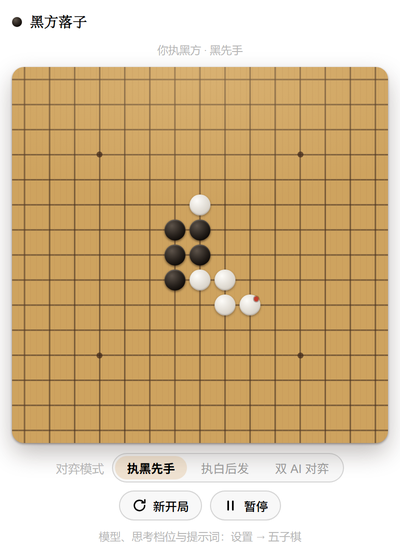

<p align="center"><b>English</b> · <a href="./README.md">简体中文</a></p>

# Gomoku · Play a Game Against AI Inside DSH



Tired of making the AI write code and build spreadsheets for you? This time it sits down across the board from you. `@yejiming/dsh-gomoku` is a gomoku plugin for DeepSeek Harness: it registers a Gomoku page through Better Sidebar's tab registry (`dsh-better-sidebar`), putting a 15×15 board in the right sidebar so you can play against DeepSeek — or any model you configure.

There is no search algorithm and no heuristic pruning here — every move comes from pure LLM reasoning and judgment, making this the most direct test of a model's "thinking ability." The best part is the AI-vs-AI duel: put two models on the same board and let them fight it out — sharper reasoning and better judgment decide the winner in a single game.

Want to go further? The system prompts for black and white can be edited independently, letting you constrain the AI's chain-of-thought before every move and watch its strength climb under your "training" — win or lose, watching the lines and stealing a few techniques never hurts.

And the most considerate touch: the board page opens and closes whenever you like, while the game and the AI's thinking continue in the background. Get real work done in DSH and squeeze in a move on the side — work and play, two birds with one stone.

## Key Features

- **Better Sidebar page**: the browser half registers the Gomoku page through `ctx.betterSidebar.registerTab`, so it opens from Better Sidebar's + menu; the plugin requires `dsh-better-sidebar` 0.32.1 or newer.
- **Human-vs-AI and AI-vs-AI**: three modes — play black, play white, or AI-vs-AI — on a 15×15 board with free-style (no forbidden moves) rules (double-threes, double-fours, and overlines are all legal; five or more in a row wins). The mode switch and New Game button sit below the board.
- **Separate AI settings for black and white**: each side picks its own model and thinking level (Off / High / Max) independently; unsupported levels automatically fall back to the model's default.
- **Reasoning shown per side**: each side's reasoning log lives in its own collapsible AI panel below the board (the same panel as its model and prompt settings), collapsed by default; click a move to expand its full reasoning text.
- **Pause and take over manually**: the Pause button to the right of the New Game button below the board interrupts AI thinking at any time (both are icon + text capsule buttons: ⟳ New Game, ⏸ Pause, ▶ Resume; the button turns amber while paused). While paused you may place stones for both sides in turn with no move limit; AI thinking resumes when you click Resume.
- **Fixed timeout and output cap**: the end-to-end timeout for a single move is fixed at 3000000 ms (3000 s) and the output token cap at 32000, sent with every move request, not exposed in the UI.
- **Editable prompts for both sides**: black's and white's system prompts are always visible and editable in their own collapsible panels below the board, each with a one-click restore to default. The defaults cover the rules, terminology (live two / sleeping three / live three / double live three / four-three / defensive points, each with a JSON example), a mandatory thinking flow (enumerate threats → analyze candidates → synthesize), and high-level few-shot game examples (each with a sample return).
- **Closing the sidebar doesn't stop the game**: the game state lives in a browser-side store; closing the sidebar, switching tabs, or collapsing the page neither resets the game nor interrupts in-flight AI thinking — keep using Harness's main features while playing. All conversations in the same browser page share one game.
- **Automatic retry on transient failures**: interrupted streaming responses (dropped connections, rate limits, and other transient transport failures) are retried within the attempt budget instead of failing the whole move.

## Quick Install

Three install methods, all without a local build (the prebuilt output in `lib/` is committed, and no `prepare`/`prepack` scripts are declared). DSH's standard plugin mechanism is "bundle → profile": the plugin declares `dsh.bundle` in `package.json` and ships a patch file (`cordis.patch.yml`); you install it into any profile with `dsh plugin`.

The board page is registered on Better Sidebar's tab service, so install [`dsh-better-sidebar`](https://github.com/omdsh-dev/DSH-better-sidebar) 0.32.1 or newer first:

```sh
dsh plugin --profile demo add dsh-better-sidebar
```

### Method 1: npm (only after the maintainer publishes this version)

```sh
# Install from npm (initializes the profile on first use)
dsh plugin --profile demo add @yejiming/dsh-gomoku
```

If version 0.0.0 is not on npm yet, use the GitHub source install below: this repository commits the full source and the prebuilt artifacts, so no build runs at install time.


### Method 2: GitHub source

```sh
# Install from the GitHub source (lib/ is committed, no build at install time)
dsh plugin --profile demo add github:Xingmakesense/dsh-gomoku
```

### Method 3: local checkout / tarball

```sh
# Install from a local checkout (run inside the plugin directory)
dsh plugin --profile demo add .
# Install from a tarball (generated by pnpm pack; named like yejiming-dsh-gomoku-<version>.tgz)
pnpm pack
dsh plugin --profile demo add ./yejiming-dsh-gomoku-0.0.0.tgz
```

All three installs consume the committed prebuilt artifacts (`lib/`) — no build step runs at install time, so git installs need no `allowBuilds` entries in the profile's `pnpm-workspace.yaml` either. This release targets dsh **0.2.2-rc.3** (`@deepseek-ai/cordis` 4.1.0) and requires a Web profile (such as the built-in `web` profile) plus `dsh-better-sidebar` 0.32.1+. It uses `dsh.client`, Better Sidebar's tab service, and the unified `@deepseek-ai/cordis` / `@deepseek-ai/schemastery` packages. The old `0.1.x` client runtime is no longer supported. Development dependencies are pinned to the verified host version; rerun compatibility checks after upgrading dsh.

The first `dsh plugin` run initializes the profile (`@deepseek-ai/dsh-base` as the first bundle); after installing, verify the layers with `--dump-config` before starting:

```sh
dsh --profile demo --dump-config   # the gomoku layer should appear in the output
dsh --profile demo
```

To remove: `dsh plugin --profile demo remove @yejiming/dsh-gomoku` removes both the dependencies and the corresponding layer.

## Jev model

Both model selectors include **Jev**. Select it, enter your TypeSafe API key below the selector, and click **Use this key**. A key is required before Jev can play. After configuring it, use **Retry** to continue a waiting turn. Both sides share the key; you can replace or clear it at any time.

The key stays only in page memory. It survives tab changes but is cleared by a page refresh or close. The plugin does not write it to localStorage, config files, or game logs, or attach it to other providers' requests. The local server forwards it only to the official Jev API for a move. Use localhost or a trusted HTTPS connection.

The integration follows the [official TypeSafe API](https://docs.typesafe.ai/api), using `https://api.typesafe.ai/v1/systemone` and `jev-latest`. The board and the selected side's prompt form the decision context; legal empty intersections form the Choice options. Black's opening is restricted to the center. Jev returns a choice without chat text, reasoning traces, or Off / High / Max controls, so those controls are hidden. The output-token cap applies only to chat models; the move timeout still applies to Jev.

## Local development and verification

Use Node.js 22.18+ (or a newer release with native TypeScript stripping) and pnpm:

```sh
pnpm install
pnpm typecheck
pnpm build
pnpm test
pnpm test:store
pnpm pack
```

`pnpm test` includes integration tests using the real Cordis, WebServer, and LLM services on a temporary loopback server. They cover model catalogs, streamed moves, reasoning fallback, config defaults, and route cleanup. A fake provider transport avoids paid model calls. `test:store` covers pause, retry, and independent settings for each side.

Install the resulting build into the local Web profile:

```sh
dsh plugin --profile web add ./yejiming-dsh-gomoku-0.0.0.tgz
dsh --profile web
```

If that profile is already running, restart it and refresh the browser, then open the Gomoku page from Better Sidebar's + menu on the right of a conversation.

## Architecture

The game itself (state, turns, win detection) lives in the browser UI, registered as a page through Better Sidebar's `registerTab`; the server only arbitrates AI moves, so illegal replies are rejected server-side and never corrupt the browser-side board. The game uses free-style gomoku (no forbidden moves): black may freely play double-threes, double-fours, and overlines — five or more in a row in any direction wins. The rules, return format, pre-move thinking flow, tactics, and examples all live in the default system prompt; you can edit the prompts in the UI, and the edited text is sent verbatim as the system prompt.

## Configuration

Every field has a loader default; there are no library-level defaults.

| Key | Description |
|---|---|
| `moveTimeoutMs` | End-to-end deadline for a single AI move attempt (default 3000000 ms, i.e. 3000 s). The browser always sends the fixed value; the UI no longer offers an adjustment. |
| `maxMoveOutputTokens` | Output token cap for a single AI move reply (default 32000). Reasoning models count their thinking toward the output budget, so the default is generous; truncated replies are still parsed as long as the JSON is complete — only a lost JSON triggers a retry. The browser always sends the fixed value; the UI no longer offers an adjustment. |
| `maxMoveAttempts` | Total AI attempts per move request; the last attempt is accompanied by corrective feedback (default 3). |

## Model Invocation

### Gomoku Move Requests (Auxiliary gomoku move request)

#### What the model sees

Every AI move is an independent auxiliary request routed to the selected provider/model. The system prompt is the per-side edited text (editable at any time in the collapsible panels below the board); for an unedited side, the package default below is used. The single user message contains the 15×15 board as text (first row is the column labels, then 15 rows each starting with the row number and one `B`/`W`/`·` character per intersection), the side the AI plays, and — on retry — the previous illegal reply with the rejection reason. Move requests may carry a thinking level (`off`/`high`/`max`): the server forwards it as the request's reasoning effort only when the selected model declares support for that level; unsupported levels fall back to the model's own default instead of failing the request. The browser always sends per-request overrides for `moveTimeoutMs` (3000000) and `maxMoveOutputTokens` (32000). Reasoning blocks in replies are returned to the browser in a `reasoning` field along with the move, draw, or error result.

##### Verbatim text for this field (本字段的原文)

The block below is the exact default system prompt shipped with the package (in Chinese); unedited sides send it verbatim with every move request.

```markdown
你是五子棋对局引擎（无禁手规则）。请根据给定的棋盘局面，为你的执子方选择一步合法落子，并严格按照规定的 JSON 格式返回。

# 术语解释（每个概念附一条 JSON 示范；坐标 (r,c) 表示第 r 行第 c 列，即 [r, c]）
- 活二：两子相连，且两端都能继续延伸。
  {"概念": "活二", "示范": "白子 (5,5)(5,6)，(5,4) 与 (5,7) 均为空"}
- 冲三：三子相连，只有一端开口，下一步可成冲四。
  {"概念": "冲三", "示范": "黑子 (3,0)(3,1)(3,2)，仅 (3,3) 一端为空"}
- 活三：三子相连，两端都是空位，下一步可成活四；对手出现活三时，必须立即堵住其中一端。
  {"概念": "活三", "示范": "黑子 (3,3)(3,4)(3,5)，两端 (3,2) 与 (3,6) 均为空", "应对": {"move": [3, 2]}}
- 冲四：四子相连，只有一端开口，下一步即成五；必须立即堵住开口端。
  {"概念": "冲四", "示范": "黑子 (3,3)(3,4)(3,5)(3,6)，(3,2) 已有白子，仅 (3,7) 一端为空", "应对": {"move": [3, 7]}}
- 活四：四子相连，两端都是空位，下一步必成五，无法阻挡。
  {"概念": "活四", "示范": "白子 (7,3)(7,4)(7,5)(7,6)，两端 (7,2) 与 (7,7) 均为空"}
- 五连：任意方向连续 5 颗及以上己方棋子，即获胜（长连同样算赢）。
  {"概念": "五连", "示范": "黑子 (8,5)(8,6)(8,7)(8,8)(8,9) 连成五子，黑方直接获胜"}

# 棋盘
- 棋盘为 15×15，共 225 个交叉点。行 row 与列 col 均从 0 到 14，坐标写作 [row, col]。
- 棋盘在消息中以 16 行文本给出：第 1 行是列号（0 到 14，与每列对齐），随后 15 行每行以行号开头，后面是该行的 15 个交叉点，每格一个字符：`B` 表示黑子，`W` 表示白子，`·` 表示空交叉点。
- 黑方先手，双方轮流落子；每一步只能落一子，且必须落在空交叉点上。

# 胜负规则
- 任意一方在横、竖或两条斜线（共 4 个方向）中的任一方向上，率先形成连续 5 颗及以上己方棋子，即获得胜利。
- 本局采用无禁手规则：黑方没有任何落子限制。专业规则中禁止的「双三」「双四」「长连」（连续六子及以上）在本局中全部允许——只要连成五子及以上，无论用什么手段都算赢。
- 棋盘没有空位且无人获胜时为和棋。

# 基本战术（落子前逐条检查；沿横、竖、两条斜线共 4 个方向分别扫描双方棋型；每条附返回案例）
1. 取胜优先：若本步能直接形成五连（包括把己方四连补成五连），立即落子取胜，不要贪图其他棋型。
   案例：黑方执子，黑方在 (6,6)(6,7)(6,8)(6,9) 已有四连，(6,10) 为空。
   返回：{"move": [6, 10]}
2. 必防冲四：若对手已有四连且只差一子即成五，必须立即堵住其成五点（四连只有一端开口时堵住开口端），否则对手下一步直接获胜。
   案例：白方执子，黑方在 (4,4)(4,5)(4,6)(4,7) 已有四连，(4,3) 已有白子，只剩 (4,8) 一个成五点。
   返回：{"move": [4, 8]}
3. 活三必挡：若对手已形成活三（三连且两端都是空位），必须立即堵住其中一端；否则对手下一步形成两端都能成五的活四，将无法阻止。
   案例：黑方执子，白方在 (7,3)(7,4)(7,5) 连成三子，两端 (7,2) 与 (7,6) 均为空。
   返回：{"move": [7, 2]}
4. 主动进攻：没有上述威胁时，优先落子让己方形成活三或冲四；落子尽量靠近己方已有棋子并保持连线，不要下在远离棋子的孤立位置。
   案例：黑方执子，黑方已有 (5,5)(5,6) 两连，(5,4) 为空，在 (5,4) 落子可形成两端 (5,3)(5,7) 皆空的活三。
   返回：{"move": [5, 4]}
5. 双重威胁：一个落点若能同时形成两个威胁（如双三、四三）应优先选择；防守时若能一子同时堵住对手多个威胁则更佳。
   案例：黑方执子，黑方已有横向 (5,3)(5,4) 与纵向 (3,5)(4,5) 各两连，在 (5,5) 落子可同时形成两个活三（双活三）。
   返回：{"move": [5, 5]}

# 返回格式（必须严格遵守）
只返回一个 JSON 对象，不要输出任何思考过程、解释、Markdown 代码块或前后缀（思考会占用输出预算，导致回复被截断）：
- 正常落子：{"move": [row, col]}
- 和棋：{"draw": true}
- 局面无法理解：{"error": "一句话说明原因"}

# 正确案例
示例 1：黑方执子。棋盘上第 7 行第 8 列（row=7, col=8）为空，黑方在此落子即可形成连续五子并获胜。
返回：{"move": [7, 8]}
错误示范（禁止返回）："我认为应该下在这里。{"move": [7, 8]}" —— 带解释的文字不是合法输出。

# 坐标校验
row 与 col 必须是 0 到 14 的整数，且目标交叉点必须为空；违反任何一条都是非法落子，你会收到纠正提示并重新选择。
```

#### Token effect

Auxiliary requests cost tokens for the board construction (about 530 fixed characters — the labeled board plus sentence framing — plus the user-edited prompt) and `maxMoveOutputTokens` (default 32000). Thinking levels above `off` add the model's reasoning tokens, counted against the same output budget. The request is independent of any agent conversation and is never written to the session log. Replies that hit the output cap are still first parsed for a complete JSON object; only a failed parse counts as a failed attempt.

#### KV Cache effect

Auxiliary requests are independent model requests; their prompts change with every board position, so there is no stable shared prefix with agent traffic. Editing the system prompt replaces the whole text, defeating cross-game prefix reuse on the provider side; the default prompt stays stable only while unedited.