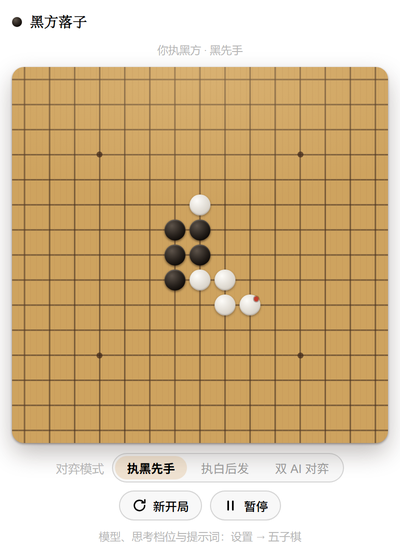
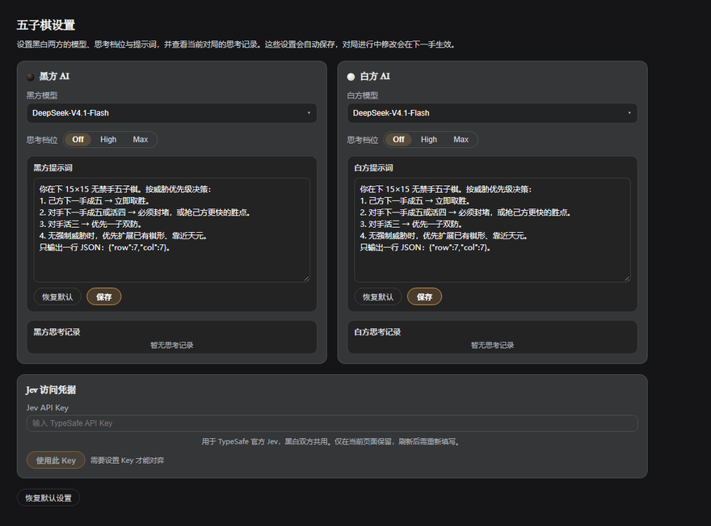

<p align="center"><a href="./README.en.md">English</a> · <b>简体中文</b></p>

# 五子棋（Gomoku）· 在 DSH 里和 AI 杀一盘

<p align="center">
  <br />
  
</p>

总是让 AI 帮你写代码、做表格？这次换它陪你下棋。`@yejiming/dsh-gomoku` 是 DeepSeek Harness 的五子棋插件：通过 Better Sidebar（`dsh-better-sidebar`）的标签注册服务，把「五子棋」作为一个独立页面放进右侧边栏，摆上一盘 15×15 的棋盘，让 DeepSeek 或任何你配置好的模型执子对弈。

这里没有搜索算法，也没有启发式剪枝——每一步落子都来自 LLM 纯粹的推理与判断，堪称对模型「思考能力」最直观的考验。最过瘾的当属双 AI 对战：让两个模型同台厮杀，谁的推理更缜密、更懂审时度势，一局见分晓。

想更进一步？黑、白两方的系统提示词可以分别编辑，约束 AI 落子前的思维链，亲眼看着棋力在你的「调教」下节节攀升——输赢先不论，围观棋路、偷师几手也不亏。

最贴心的是：棋盘页面想开就开、想关就关，对局和 AI 的思考在后台照常进行。一边用 DSH 处理正事，一边偷空落一子，摸鱼与工作两不误。

## 主要功能

- **Better Sidebar 页面入口**：客户端半部通过 `ctx.betterSidebar.registerTab` 注册「五子棋」页面，从 Better Sidebar 的 + 菜单即可打开；插件依赖 `dsh-better-sidebar` 0.32.1 及以上版本。棋盘页只保留棋盘与开局控制。
- **独立的设置页**：模型、思考档位、系统提示词与 Jev 凭据都在「设置 → 五子棋」中调整，同时可查看当前对局的思考记录；选择自动保存（Jev Key 仅保留在页面内存），对局中修改下一手生效。
- **盘面威胁提示**：每次落子请求会附带服务端计算的威胁清单——对方可直接成五、活三（落子即形成活四）与冲四点，以及己方机会——写进用户消息提示模型优先防守；它只作参考，不强制模型落子。
- **人机与双 AI 对弈**：支持执黑、执白、双 AI 对弈三种模式，15×15 无禁手规则（双三、双四、长连均合法，连成五子及以上即胜）。对弈模式与新开局按钮位于棋盘下方。
- **黑白 AI 分别设置**：黑、白两方的模型与思考档位（Off / High / Max）在设置页分别选择，互不影响；模型不支持所选档位时自动回落其默认档位。
- **思考过程分侧展示**：黑、白两方的思考记录在设置页各自的面板中（与模型、提示词同侧），默认折叠，点击某手可展开该步的完整推理文本。
- **暂停与手动接管**：棋盘下方【新开局】按钮右侧的【暂停】按钮可随时中断 AI 思考（两者均为「图标 + 文字」的胶囊按钮：⟳ 新开局、⏸ 暂停、▶ 继续，暂停中按钮转为琥珀色高亮）；暂停期间你可为黑白双方轮流落子，没有步数限制，再次点击【继续】后 AI 恢复思考。
- **固定超时与输出上限**：单次落子的端到端超时固定为 3000000 毫秒（3000 秒）、输出 token 上限固定为 32000，随每次落子请求发送，不在界面中暴露。
- **黑白提示词分开编辑**：黑、白两方 AI 的系统提示词在设置页中分别常驻编辑，各自可一键恢复默认。默认提示词采用紧凑的「威胁优先」结构（约 887 字符）：先成五/封五，再处理冲四、活三与双威胁，最后在最多 6 个候选点内按攻防价值择优。提示词越短，模型把预算越集中在盘面判断上，思考更快、落子更直接。
- **侧边栏关闭不中断对局**：棋局保存在浏览器端 store 中，关闭侧边栏、切换标签或收起页面都不会重置棋局，也不会中断正在进行的 AI 思考，可以一边使用 Harness 主功能一边对弈。同一个浏览器页面内的各会话共享同一盘棋。
- **瞬时失败自动重试**：流式响应中断（连接断开、限流等瞬时传输故障）会在尝试预算内自动重试，不会直接让整步棋失败。

## 快速安装

支持三种安装方式，均**无需本地构建**（构建产物 `lib/` 已提交进仓库，且不设 `prepare`/`prepack` 脚本）。DSH 的标准插件安装机制是「组合包 → profile」：插件包在 `package.json` 中声明 `dsh.bundle` 并附带 patch 文件（`cordis.patch.yml`），用户用 `dsh plugin` 把它安装进任意 profile。

棋盘页面注册在 Better Sidebar 的标签服务里，因此使用前还需安装 [`dsh-better-sidebar`](https://github.com/omdsh-dev/DSH-better-sidebar) 0.32.1 或更高版本：

```sh
dsh plugin --profile demo add dsh-better-sidebar
```

### 方式一：npm 安装（需维护者已发布该版本）

```sh
# 从 npm 安装（首次使用会初始化该 profile）
dsh plugin --profile demo add @yejiming/dsh-gomoku
```

若 npm 上尚未发布 0.0.1 版本，请改用下面的 GitHub 源码安装：本仓库已提交完整源码与构建产物，安装时无需构建。


### 方式二：GitHub 源码安装

```sh
# 从 GitHub 源码安装（仓库已提交构建产物 lib/，安装时无需构建）
dsh plugin --profile demo add github:Xingmakesense/dsh-gomoku
```

### 方式三：本地 checkout / tarball 安装

```sh
# 从本地 checkout 安装（在插件目录内执行）
dsh plugin --profile demo add .
# 从 tarball 安装（tarball 由 pnpm pack 生成，文件名形如 yejiming-dsh-gomoku-<版本>.tgz）
pnpm pack
dsh plugin --profile demo add ./yejiming-dsh-gomoku-0.0.1.tgz
```

以上方式都直接使用仓库内提交的预构建产物（`lib/`），安装时不需要执行构建脚本——从 git 安装也无需在 profile 的 `pnpm-workspace.yaml` 里配置 `allowBuilds`。当前版本适配 dsh **0.2.2-rc.3**（`@deepseek-ai/cordis` 4.1.0），需要 Web profile（如内置的 `web` profile）与 `dsh-better-sidebar` 0.32.1+。插件使用新版 `dsh.client` 声明、Better Sidebar 的标签服务，以及统一的 `@deepseek-ai/cordis` / `@deepseek-ai/schemastery` 接口；不再兼容旧的 `0.1.x` 客户端运行时。开发依赖固定为本次验证的宿主版本，升级 dsh 后应重新执行兼容性检查。

首次使用 `dsh plugin` 会初始化该 profile（`@deepseek-ai/dsh-base` 作为第一个组合包）；安装后先用 `--dump-config` 验证层，再启动：

```sh
dsh --profile demo --dump-config   # 输出中应出现 gomoku 层
dsh --profile demo
```

移除：`dsh plugin --profile demo remove @yejiming/dsh-gomoku` 会同时移除依赖与对应层。

## Jev 模型

黑方、白方的模型列表均提供 **Jev**。选择后，在模型下方填写 TypeSafe API Key 并点击「使用此 Key」。未设置有效格式的 Key 时不会发起 Jev 落子请求；设置后可点击「重试」继续当前回合。可随时替换或清除 Key，两个执子方共用同一设置。

Key 只在当前页面内存中保留：切换标签不丢失，刷新或关闭页面后需重新填写。插件不会将 Key 写入 localStorage、配置文件或棋局日志，也不会随其他模型的请求发送。仅在 Jev 落子时通过本地服务端转发给官方 API；请在本机或可信的 HTTPS 连接中使用。

接入遵循 [TypeSafe 官方 API 文档](https://docs.typesafe.ai/api)，固定使用 `https://api.typesafe.ai/v1/systemone` 和 `jev-latest`。插件把棋盘与该方提示词作为决策上下文，把所有合法空点作为 Choice 候选；黑方首手仅允许天元。Jev 不生成聊天回复、思维链，也不支持本插件的 Off / High / Max 档位，因此选择 Jev 后隐藏档位选项。输出 token 上限只作用于普通聊天模型；超时仍适用于 Jev。

## 本机开发与验证

使用 Node.js 22.18+（或支持原生 TypeScript 类型擦除的更新版本）和 pnpm：

```sh
pnpm install
pnpm typecheck
pnpm build
pnpm test
pnpm test:store
pnpm pack
```

`pnpm test` 包含真实 Cordis、WebServer 和 LLM 服务的集成测试：在回环地址启动临时服务，验证模型列表、落子流、思考档位回退、配置默认值和卸载清理；模型传输由测试替身提供，不调用付费模型。`test:store` 验证暂停、重试与黑白两方的独立设置。

将本次构建安装到本机 Web profile：

```sh
dsh plugin --profile web add ./yejiming-dsh-gomoku-0.0.1.tgz
dsh --profile web
```

若该 profile 已在运行，重启后刷新浏览器，在会话右侧 Better Sidebar 的 + 菜单中选择「五子棋」页面。

## 架构

棋局本身（状态、回合、胜负判定）在浏览器界面中，页面通过 Better Sidebar 的 `registerTab` 注册；服务端只仲裁 AI 落子，因此非法回复在服务端被拒绝，不会破坏浏览器端的棋盘。游戏采用自由式五子棋（无禁手）：黑方可以自由下双三、双四与长连——任意方向连续五子及以上即获胜。规则、返回格式、威胁优先级、候选评分与输出约束都在默认系统提示词中；用户可以在界面中手改提示词，修改后的文本会原样作为系统提示词发送。

## 配置

所有字段都有 loader 默认值；无库级默认值。

| 键 | 说明 |
|---|---|
| `moveTimeoutMs` | 单次 AI 落子尝试的端到端截止时间（默认 3000000 毫秒，即 3000 秒）。浏览器端每次都发送固定值，界面不再提供调整。 |
| `maxMoveOutputTokens` | 单次 AI 落子回复的输出 token 上限（默认 32000）。推理模型会把思考计入输出预算，因此默认值较宽松；截断的回复只要 JSON 完整仍会被解析，只有 JSON 丢失才触发重试。浏览器端每次都发送固定值，界面不再提供调整。 |
| `maxMoveAttempts` | 每次落子请求的 AI 尝试总次数；最后一次尝试附带纠正反馈（默认 3）。 |

## 模型调用

### 五子棋落子请求（Auxiliary gomoku move request）

#### What the model sees

每次 AI 落子都是发往所选 provider/model 路由的一次独立辅助请求。系统提示词是黑、白两方各自编辑后的文本（在设置页中随时可改），某方未编辑时用下方的包默认文本；唯一的用户消息包含 15×15 棋盘文本（首行列号，随后 15 行每行以行号开头，每格一个 `B`/`W`/`·` 字符）、AI 执子方，以及（重试时）上一次非法回复与拒绝原因。落子请求还可携带思考档位（`off`/`high`/`max`）：仅当所选模型声明支持该档位时，服务端才会把它作为请求的 reasoning effort 转发；不支持的档位回落到模型自身默认值，而不是让请求失败。浏览器端固定发送按请求 `moveTimeoutMs`（3000000）与 `maxMoveOutputTokens`（32000）覆盖值。回复中的推理块会随落子、和棋或错误结果以 `reasoning` 字段返回给浏览器。用户消息末尾还会附带一段程序计算的威胁提示（对方成五/活三/冲四点、己方机会）；它只作参考，不强制落子。

##### 本字段的原文（Verbatim text for this field, when needed）

```markdown
你是五子棋落子引擎（无禁手，任意方向连成 5 子及以上即胜）。为指定执子方选择当前最优的一步合法空点。判断在内部完成，只输出 JSON。

# 快速判断（按优先级，命中即停）
1. 己方成五：任一方向己方已有连续 4 子（含跳四）且空端可成五 → 立即落子取胜。
2. 对手成五：对手 4 子的成五点 → 必须封堵；若对手活四无法单点封堵，则改走己方最快取胜点。消息中的威胁提示会列出这些点。
3. 己方强攻：能形成活四、冲四或「四三」的点优先；冲四可迫使对手应手，为下一手争取先手。
4. 对手活三：立即封堵其一端；若一子能同时封堵两个威胁（双防点），优先选双防点。威胁提示会列出对方可形成活四的点。
5. 己方活三/双活三：无紧急威胁时，选择能形成活三、双活三或多方向连线的点。
6. 布局：靠近天元与双方已有棋群，保持连线；避免边角、孤立与没有后续的落点。

# 术语
活三＝3 连且两端可延伸（下一步可成活四）；冲四＝4 连且仅一端可成五；活四＝两端均可成五、无法单点封堵；双活三/四三＝一子同时形成两个活三 / 冲四加活三，均为强杀。

# 威胁提示
每次请求附带程序计算的威胁清单：对方可直接成五 / 活三（落子即形成活四）与冲四的点，以及己方机会。它只作参考，不强制落子；出现对方成五点或活三时必须优先处理，再考虑进攻。

# 候选比较（最多评估 6 个点）
- 只考虑现有棋子 2 格以内的空点；黑方首手固定天元 (7,7)。
- 评分＝进攻价值（成 5 > 活四 > 冲四 > 活三 > 双三/四三 > 活二）＋防守价值（封成 5 > 封冲四 > 封活三/双防）。
- 同分依次比较：能否强制对手应手 → 是否连接更多棋子 → 是否更靠近中心。
- 宁可下在能持续进攻的要点，也不下没有后续的孤子。

# 输出（严格遵守）
只输出一行 JSON，不要解释或 Markdown：{"move": [row, col]}
和棋：{"draw": true}
无法判断：{"error": "一句话原因"}
row、col 为 0–14 的整数，目标点必须为空。
```

#### Token effect

辅助请求按提示词成本消耗 token（约 887 个字符的默认提示词，外加约 530 个字符的带标注棋盘文本）以及 `maxMoveOutputTokens`（默认 32000）。高于 `off` 的思考档位会增加模型的思考 token，计入同一个输出预算。该请求与任何 agent 对话相互独立，绝不写入会话日志。命中输出上限的回复仍会先尝试解析出完整 JSON 对象，解析失败才计为一次失败尝试。

#### KV Cache effect

辅助请求是独立的模型请求；其提示词随每个棋局位置变化，因此与 agent 流量之间没有稳定的共享前缀。用户编辑系统提示词会整体替换文本，使 provider 侧的跨局前缀复用失效；默认提示词只在未编辑时保持稳定。